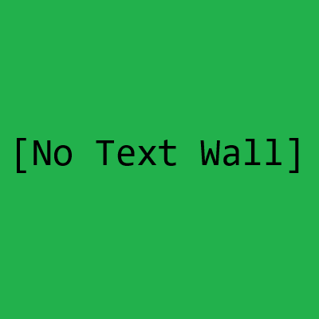
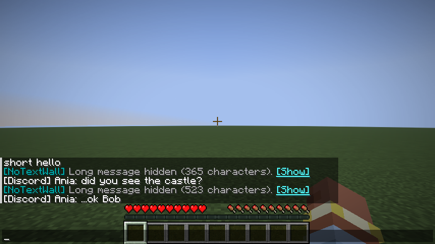
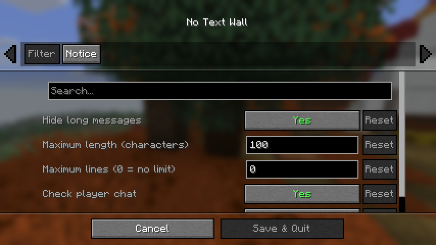
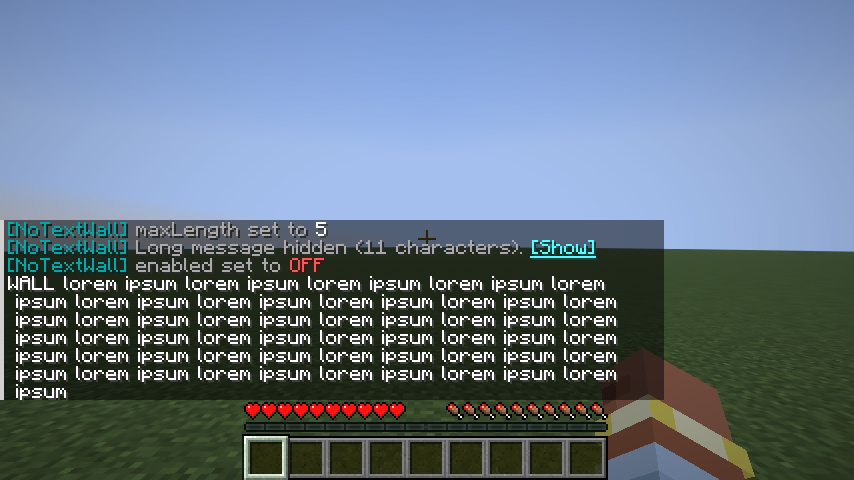

# No Text Wall



Client-side **Fabric** mod for **Minecraft 26.2 and 26.3** that hides chat messages that are too long.

Tired of someone pasting an entire Wikipedia article on Discord, and a Discord-to-Minecraft bridge showing it all in-game as a wall of text that blocks your view? But you still like chatting normally with people on Discord, so you don't want to mute it all? Then this mod is for you.

Port of my original [No Text Wall [Fabric] for 1.20.4 on CurseForge](https://legacy.curseforge.com/minecraft/mc-mods/no-text-wall) ([old source](https://github.com/VashaTS/notextwall)), with the planned features added.

## Features

- Messages longer than **100 characters** (configurable) are not shown in chat.
  - Works for server/system messages (Discord bridges, plugins, `/say`, `/tellraw`, ...) and for player chat.
  - For player chat only the typed text is counted, without the `<name>` prefix (as in the original).
- Optional **line limit**: you can also hide messages with too many lines, even short ones.
- In place of a hidden message you see `[NoTextWall] Long message hidden (523 characters). [Show]`:
  - hover over **[Show]** to preview the beginning of the message,
  - click it to print the whole message once.
- **Client command** `/notextwall` (alias `/ntw`) changes the config in-game. This was the feature planned for 0.3.
- **Mod Menu + Cloth Config** settings screen. Both are optional: without them the mod uses the config file and the command.
- Changes apply **immediately**, no restart needed. On load, new options are added to an old config file automatically.
- English and Polish translations, following the game language.
- **Entirely client side**: it only affects the messages you see. Servers do not need it.

## Screenshots

Walls of text hidden, normal chat still visible:



Settings screen (Mod Menu + Cloth Config):



With the filter off (`/notextwall off`), the whole wall is shown:



## Commands

| Command | What it does |
|---|---|
| `/notextwall` or `/notextwall status` | show current settings |
| `/notextwall on` / `off` | turn the filter on / off |
| `/notextwall maxLength <1-32767>` | maximum message length in characters |
| `/notextwall maxLines <0-100>` | maximum number of lines (0 = no limit) |
| `/notextwall showCancelMessage <true\|false>` | show the "Long message hidden" notice |
| `/notextwall showPreview <true\|false>` | hover preview and [Show] button on the notice |
| `/notextwall filterPlayerChat <true\|false>` | check player chat messages |
| `/notextwall filterSystemMessages <true\|false>` | check server/system messages |
| `/notextwall last` | reveal the last hidden message |
| `/notextwall show <id>` | reveal hidden message number `id` (the last 50 are remembered until you quit) |
| `/notextwall reload` | reload `config/notextwall.json` after editing it by hand |
| `/notextwall reset` | restore defaults |

## Configuration file

`.minecraft/config/notextwall.json`. The file name is the same as in the 1.20.4 version, so an old file keeps working.

```json
{
  "enabled": true,
  "maxMessageLength": 100,
  "maxLines": 0,
  "showCancelMessage": true,
  "showPreview": true,
  "filterPlayerChat": true,
  "filterSystemMessages": true
}
```

## Requirements

- Minecraft 26.2 or 26.3, Fabric Loader, [Fabric API](https://modrinth.com/mod/fabric-api)
- Optional: [Mod Menu](https://modrinth.com/mod/modmenu) + [Cloth Config](https://modrinth.com/mod/cloth-config) for the settings screen

Branches: `master` = 26.3, `26.2` = 26.2.

## Building

```
./gradlew build                                   # jar in build/libs + unit tests
SDL_VIDEODRIVER=offscreen ./gradlew runClientGameTest   # end-to-end test in a real client
```

## Special thanks

To IDK and ThisMFB for inspiring this mod's creation, and to Akoot for being a patient overseer.

## License

MIT
